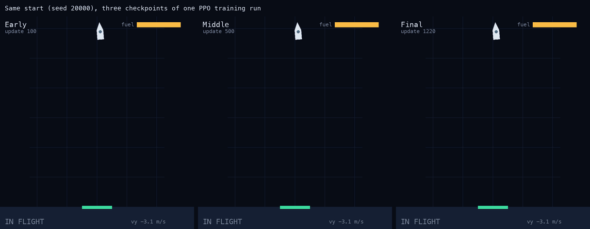
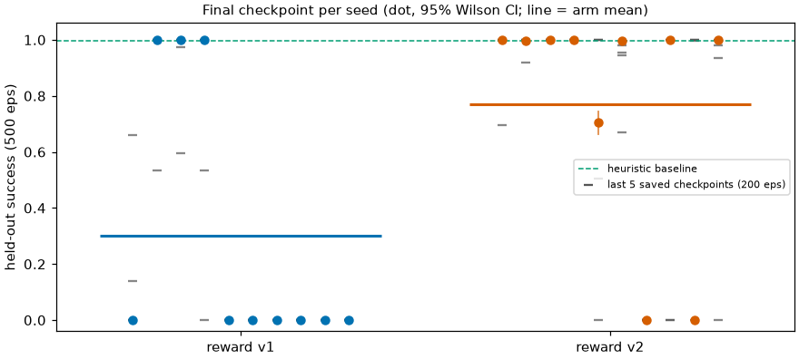
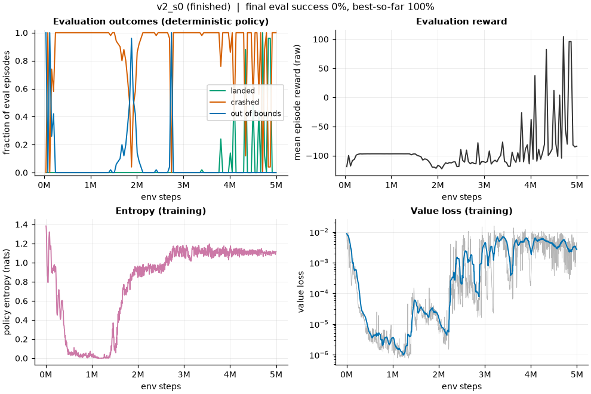
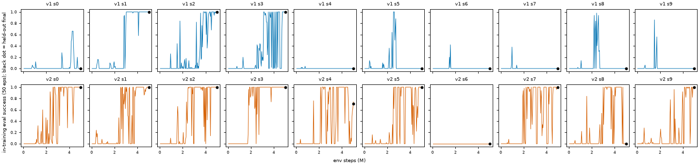
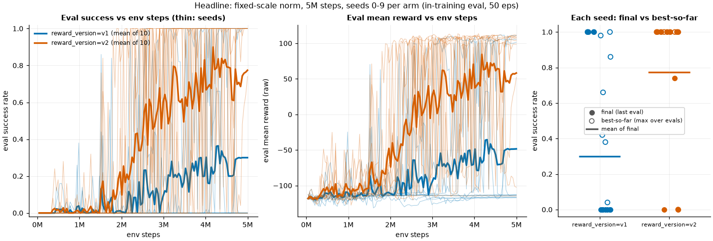
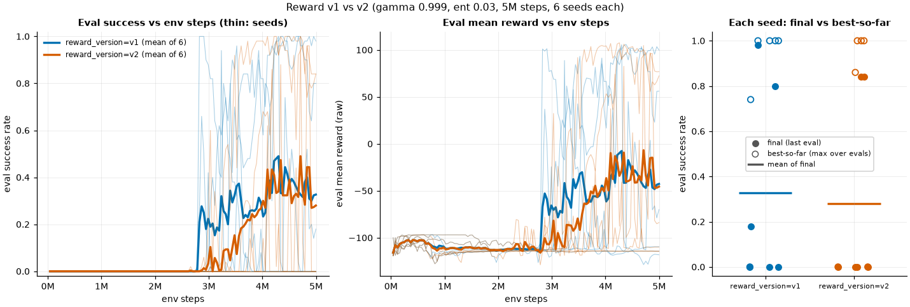
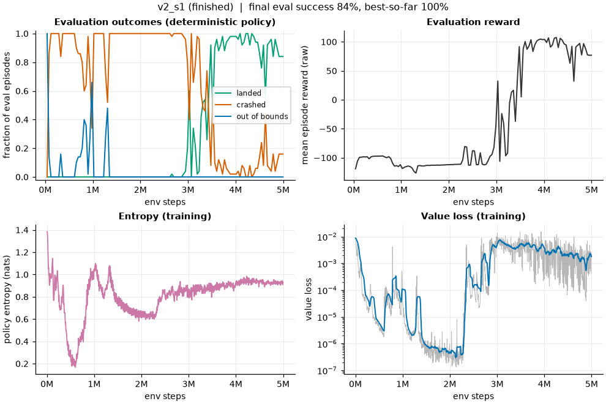

# Rocket Landing RL

[](https://github.com/LeooJinn/rocket-landing-rl/actions/workflows/tests.yml)

A from-scratch PyTorch PPO agent that learns to land a simulated 2D rocket on a pad. It sees seven numbers
(position, velocity, tilt, spin, fuel), picks one of four thrusters each step, and is trained with a
shaped reward on a deterministic NumPy simulator. The repo also contains a hand-written heuristic
controller as a baseline, a held-out evaluation protocol with confidence intervals, a browser replay
viewer, and the experiment log of what went wrong along the way. With the better of two reward versions,
7 of 10 training seeds end with a policy that matches the heuristic baseline (99.6% held-out success); the
other 3 do not, and I have not yet made training reliable. The write-up below says which numbers are solid
and which are not.

**Live demo (recorded runs, no server needed): <https://jiaxiangjin.com/rocket-landing-rl/>**



## Headline result

Reward v1 vs reward v2, same PPO settings, fixed-scale observation normalisation, 5M environment steps,
10 training seeds per arm. Each cell is the **final checkpoint** (never best-so-far) evaluated greedily on
**500 held-out episodes** (reset seeds 50000..50499, disjoint from every training and validation seed),
with the 95% Wilson interval for that one policy. Source: [docs/headline-results.md](docs/headline-results.md),
raw data in [experiments/headline_eval.json](experiments/headline_eval.json) and
[experiments/headline_stats.json](experiments/headline_stats.json).

| train seed | reward v1 | reward v2 |
|---|---|---|
| 0 | 0.0% [0.0, 0.8] | 100.0% [99.2, 100.0] |
| 1 | 100.0% [99.2, 100.0] | 99.8% [98.9, 100.0] |
| 2 | 100.0% [99.2, 100.0] | 100.0% [99.2, 100.0] |
| 3 | 100.0% [99.2, 100.0] | 100.0% [99.2, 100.0] |
| 4 | 0.0% [0.0, 0.8] | 70.6% [66.5, 74.4] |
| 5 | 0.0% [0.0, 0.8] | 99.8% [98.9, 100.0] |
| 6 | 0.0% [0.0, 0.8] | 0.0% [0.0, 0.8] |
| 7 | 0.0% [0.0, 0.8] | 100.0% [99.2, 100.0] |
| 8 | 0.0% [0.0, 0.8] | 0.0% [0.0, 0.8] |
| 9 | 0.0% [0.0, 0.8] | 100.0% [99.2, 100.0] |
| **mean over seeds** | **30.0%** | **77.0%** |
| median | 0.0% | 99.9% |
| seeds at or above 90% | 3 / 10 | 7 / 10 |
| seeds at 0% | 7 / 10 | 2 / 10 |

Reference points on the same 500 episodes: the **heuristic controller lands 99.6%** (498/500, CI 98.6 to
99.9) and a **uniform-random policy 0.0%** (0/500, CI 0.0 to 0.8).



How to read this:

- **Reward v2 is better on every summary I computed, but with 10 seeds per arm the evidence is suggestive,
  not conclusive.** Mean difference +47.0 percentage points, bootstrap 95% CI +7.0 to +80.0 (resampling
  seeds), exact permutation test p = 0.070. Seeds at or above 90%: 7/10 vs 3/10, Fisher exact p = 0.18.
  Per-seed outcomes are close to bimodal (about 0% or about 100%), so a 10-seed mean is very noisy.
- **Training is not fully stable, even with fixed scales.** 2 of 10 v2 seeds and 7 of 10 v1 seeds end in a
  policy that crashes on every episode. Many runs swing between 0% and 100% from one saved checkpoint to
  the next: 6 of 10 v2 seeds and 4 of 10 v1 seeds have a spread above 20 percentage points across their last
  five checkpoints. For example v2 seed 8 scores 100% on four consecutive checkpoints and then 0% at the end.
  The final-checkpoint number is a snapshot of where training stopped, not a stable property of the run.
- The Wilson intervals are tight because each cell is 500 episodes of one fixed policy. They say nothing
  about seed-to-seed variation, which is where almost all the uncertainty is.
- A landed policy is not a better pilot than the heuristic. The committed checkpoint `hl_v2_s2` (v2 seed 2,
  100.0%, 500/500) touches down more gently (mean touchdown descent speed 0.78 vs 1.14 m/s) but takes 423 vs
  270 steps and burns 0.61 vs 0.37 of the tank ([experiments/headline_eval.json](experiments/headline_eval.json)).

## What I learned and diagnosed

**1. The running observation normaliser was destabilising PPO (code review, then an experiment).**
A review of the training code flagged two suspects: the running mean/std normaliser changes while a
rollout is being collected, so one buffer mixes several normalisations, and it amplifies the almost
constant fuel feature by 30 to 300 times. I replaced it with stateless physical scales
(`clip(x / [50, 100, 10, 10, 0.3, 0.5, 1], -10, 10)`, chosen once by reasoning, not tuned). On train seeds 0-5,
final checkpoint, 200 held-out episodes: **mean success 27.6% with running normalisation (2/6 seeds above 50%)
vs 95.0% with fixed scales (6/6 seeds)**. Caveats: n = 6, the control arm was reused from earlier runs rather
than re-run, and the experiment does not separate the two suspected causes
([docs/normalisation-experiment.md](docs/normalisation-experiment.md)). Fixed scales are now the code default.

**2. Extending to 10 seeds showed that "6/6 seeds fine" overstated reliability.**
Seeds 0-5 reproduce the earlier result (mean 95.0% again; per seed 100 / 99.8 / 100 / 100 / 70.6 / 99.8), but
seeds 6 and 8 collapse to 0%, so over 10 seeds the v2 mean is **77.0%** and 8 of 10 seeds are above 50%
([docs/headline-results.md](docs/headline-results.md)). The first six seeds happened not to include the
collapsed ones, so a 6-seed result had looked like a fix.

**3. A flat crash penalty gives the optimiser two bad attractors, and reward v2 targets one of them.**
Early runs with reward v1 (flat -100 for any crash) repeatedly sat at one of two failure modes, seen directly
in the training logs: *free-fall* (about 85 steps, about no fuel, return about -96.5) and *hover until the
tank is empty, then crash* (about 800 steps, return about -115). The explanation in
[docs/experiments.md](docs/experiments.md): falling fast collects about +10 of distance shaping against
about -4.4 of speed shaping, so a quick crash beats any careful approach that still crashes; and with a
discount below 1, a crash 800 steps away looks cheap. Reward v2 grades the crash penalty from -100 to -50 by
how close the touchdown was to the safe limits ([docs/reward-design.md](docs/reward-design.md)). With the
running normaliser and 6 seeds it made no difference (mean final in-training eval success 0.280 vs 0.327 for
v1, [docs/experiments.md](docs/experiments.md)). With fixed scales and 10 seeds it looks better (table above,
p = 0.07). I have not tested whether the normaliser problem was masking the reward effect, so I do not claim
to know why. A higher entropy bonus (0.02 to 0.03) and a long horizon (gamma 0.999) were the only settings that let
some seeds escape both attractors.

**4. Runs collapse late in training, and final-checkpoint numbers hide it.**
Many runs reach 100% evaluation success and later fall back to 0%. In an earlier running-normaliser run
(`v2_s0`, figure below) policy entropy rose from about 0 back to about 1.1 and the value loss rose by roughly
four orders of magnitude after about 1.5M steps. Its final greedy policy landed 0.2% of 500 held-out episodes,
yet sampling from the same policy landed 90.2%, and its `best.pt` landed 99.8%
([docs/evaluation.md](docs/evaluation.md)). So a collapse can be a greedy-policy failure rather than a lost
skill. That earlier run used the running normaliser and was not re-analysed. For the fixed-scale headline runs
a later diagnosis ([docs/collapse-diagnosis.md](docs/collapse-diagnosis.md)) found that policy entropy stays
near 1.0 nats and the value function stays accurate; the failing greedy policy simply runs out of fuel before
touchdown, while the sampled policy of the same checkpoint mostly still lands. Why the policy drifts to a
slow, fuel-hungry descent is only partly tested there.



**5. Evaluation hygiene mattered more than any hyperparameter.** Early single-seed sweeps were uninformative
(a config that looked fine on one seed failed on the next), and "best checkpoint" numbers are optimistic
because they are selected on the episodes they are reported on. The headline therefore reports per-seed final
checkpoints on seed ranges that `rocket_landing.evaluate.assert_heldout` checks are disjoint from training
([docs/evaluation.md](docs/evaluation.md)).



<!-- STABILISATION-RESULTS -->
## Stabilisation attempts (round 1 done, round 2 in progress)

The headline runs leave some seeds failing, so three fixes were tried, each in its own branch and write-up.
The diagnosis behind them ([docs/collapse-diagnosis.md](docs/collapse-diagnosis.md)): the late "collapses" are
the greedy policy running out of fuel just above the ground, while the sampled policy mostly still lands, and
nothing in reward v2 penalises a slow, fuel-hungry landing.

| Fix | What it did on training seeds 0-9 (500 held-out episodes per seed, final checkpoint) | How far to trust it |
|---|---|---|
| Entropy decay plus a learning-rate floor ([docs/stabilisation.md](docs/stabilisation.md)) | 9 of 10 seeds at or above 99.6% (mean 89.9%, one seed at 0%), against 7 of 10 (77.0%) for the headline runs | Not significant (paired sign-flip p = 0.50). Most of the gain came from two seeds that were also used to pick the config. |
| Fuel-aware reward `v3a` ([docs/reward-v3-results.md](docs/reward-v3-results.md)) | All 10 seeds landed 500 of 500 episodes, with less fuel and fewer steps than reward v2 | Suggestive: paired success p = 0.062 (five seeds better, none worse), fuel and steps p = 0.008. The variant was chosen on three pilot seeds. |
| Validation-based checkpoint selection ([docs/checkpoint-selection.md](docs/checkpoint-selection.md)) | Choosing a checkpoint on separate validation seeds lifted the headline v2 runs from 77.0% to about 90% | Mostly two seeds, bootstrap interval touches zero. It cannot rescue runs that never learn, and it is nearly a no-op once training is stable. |

**Round 2 (in progress):** the clean out-of-sample test trains four arms (v2 control, entropy schedule, `v3a`,
and the combination) on ten fresh seeds, 10-19, with the analysis plan written before any held-out result.
The training runs were still going when this was committed, so there are no round-2 numbers here yet; they
will be added to [docs/stabilisation.md](docs/stabilisation.md) and this table. Early in-training logs of the
entropy-schedule arm on the fresh seeds look mixed, so treat the round-1 gain from that fix as unproven.
<!-- /STABILISATION-RESULTS -->

## Quickstart

Requires [uv](https://docs.astral.sh/uv/) and Python 3.12 (uv fetches it). Commands run from the repo root.

```bash
# Setup. Both extras are needed for the full test suite: torch for training and its tests,
# matplotlib ("plots") for the plotting tests (skipped without it).
uv sync --extra torch --extra plots
uv run pytest

# Heuristic baseline on 100 episodes (seeds 0..99): expect 99.0% success
uv run python scripts/evaluate_baseline.py --episodes 100 --seed 0

# Evaluate a committed trained checkpoint on 500 held-out episodes (about 25 s, no training needed).
# Expect 100.0% [99.2, 100.0] for the policy, 99.6% for the heuristic, 0.0% for random.
uv run python -m rocket_landing.evaluate --run experiments/results/hl_v2_s2 --checkpoint final \
    --episodes 500 --no-write

# Train. The smoke config takes a few seconds and learns nothing; it exercises the whole pipeline.
uv run python -m rocket_landing.train --config experiments/configs/smoke.json --seed 0 --run-name smoke_s0
# A real run: 5M steps, roughly 9 minutes on one CPU thread (docs/experiments.md reports 537 s for the
# v1 reference run). Use your own --run-name; hl_v2_s2 is a committed directory.
uv run python -m rocket_landing.train --config experiments/configs/ppo_final_v2.json --seed 2 --run-name my_v2_s2

# Evaluate any run you trained (bare names resolve under experiments/results/)
uv run python -m rocket_landing.evaluate --run my_v2_s2 --checkpoint final --episodes 500
uv run python scripts/evaluate_policy.py --checkpoint experiments/results/hl_v2_s2/final.pt \
    --episodes 100 --seed 0 --compare-baseline --reward-version v2

# Training curves for a run (one PNG per run; needs the plots extra)
uv run python scripts/plot_training.py --results experiments/results --run ppo_v1_tuned_s1 --out-dir /tmp/plots
```

**View it live.** The viewer serves `frontend/` plus a JSON API over a results directory and rolls out
checkpoints on demand; it also follows a training run that is still writing files
([docs/viewer.md](docs/viewer.md)).

```bash
uv run python scripts/serve_viewer.py --results-dir experiments/results --port 8000
# open http://127.0.0.1:8000/  (lists the two committed runs: ppo_v1_tuned_s1 and hl_v2_s2, plus any you trained)
```

**Static demo (no Python server).** `frontend/demo/` is a pre-computed recording of one finished run
(`exp_fixed_s0`: v2, fixed scales, seed 0): 10 start seeds at 3 checkpoints plus the baseline, so the viewer
can replay a policy going from crashing to landing. Any static file server works, and the page falls back to
it automatically when there is no API:

```bash
cd frontend && python3 -m http.server 8000     # open http://127.0.0.1:8000/?static=1
uv run python scripts/export_static_demo.py RUN_DIR --out DIR   # re-export from another run
```


## How it works

### Environment

2D point-mass rocket with rotation, fixed timestep 0.05 s, deterministic physics, Gymnasium API, also
registered as `RocketLanding-v0`. Full detail: [docs/environment.md](docs/environment.md).

| | |
|---|---|
| **Observation** (7 floats, raw physical units) | `x` (m from pad centre), `y` (m above ground), `vx`, `vy` (m/s), `angle` (rad, 0 upright), `angular_velocity` (rad/s), `fuel` (fraction left). The policy's normaliser is stored in the checkpoint. |
| **Action** (`Discrete(4)`) | `NOOP`, `MAIN` (full main engine), `LEFT`, `RIGHT` (rotate). One action per step: it cannot thrust and rotate at once. |
| **Start state** | `x` in [-40, 40], `y` in [80, 120], `vx` in [-5, 5], `vy` in [-10, 0], `angle` in [-0.2, 0.2], full tank. |
| **Landing** | At first ground contact: on the pad (`abs(x) <= 10`), `abs(vx) <= 1`, `abs(vy) <= 2`, `abs(angle) <= 0.2`, `abs(angular_velocity) <= 0.5`. |
| **Other endings** | Crash (touchdown outside those limits), out of bounds (`abs(x) > 100` or `y > 200`), timeout (1000 steps). |
| **Physics** | Thrust-to-weight 2, gravity 9.81 m/s^2, fuel burns 20 s at full main thrust. No drag, wind, noise, landing legs or contact dynamics. |

### Reward

Per-step terms ([docs/reward-design.md](docs/reward-design.md)): potential-based shaping toward the pad
(distance, speed, tilt), a fuel cost, a small time cost, a terminal reward (+100 landed, -100 crash or out
of bounds, -50 timeout) and up to +20 for a centred, gentle landing. **v2** changes one thing: a crash earns a
softness bonus of up to +50, so crash terminals range from -100 to -50. Shaping is a difference of a
potential, so hovering earns no net shaping; the document lists the remaining ways it can still be gamed.

### Architecture

```text
 experiments/configs/*.json
            |
            v
   +-------------------+  obs / reward   +----------------------------+
   |   environment.py  |<--------------->|  train.py                  |
   |   state.py        |  4 discrete     |  ppo.py (GAE, clipped PPO) |
   |   rewards.py      |  actions        |  policy.py (actor, critic, |
   |   (v1, v2)        |                 |  observation normaliser)   |
   +---------+---------+                 +-------------+--------------+
             |                                         | writes
             | same env, same seeds                    v
             |                         experiments/results/<run>/
             |                         config.json  metrics.jsonl  eval.jsonl
             |                         ckpt_*.pt  best.pt  final.pt  summary.json
             v                                         |
   +-------------------+                               |
   |   baseline.py     |                               |
   |   (heuristic)     |------+------------------------+
   +-------------------+      |                        |
                              v                        v
                +-------------------------+   +--------------------+
                |  evaluate.py            |   |  plotting.py       |
                |  held-out seeds, Wilson |   |  scripts/plot_     |
                |  CIs, baselines         |   |  training.py (PNG) |
                +-------------------------+   +--------------------+

   recording.py --> scripts/serve_viewer.py (JSON API, live or finished runs) --> frontend/
                    scripts/export_static_demo.py --> frontend/demo/ (static JSON) --> frontend/?static=1
```

### Repo map

```text
src/rocket_landing/
  environment.py    physics, fuel, termination, Gymnasium API
  state.py          shared types (RocketState, Action, Outcome)
  rewards.py        versioned reward functions (v1, v2)
  baseline.py       heuristic controller (no learning) and its evaluation helpers
  policy.py         actor/critic MLPs, observation normalisers, checkpoints
  ppo.py            GAE and the clipped PPO update
  train.py          training loop, seeding, periodic evaluation, checkpoints
  evaluate.py       held-out evaluation with Wilson intervals, greedy/stochastic/baselines
  plotting.py       training and comparison plots from run directories
  recording.py      episode trajectories as JSON for the viewer
scripts/            evaluate_baseline, evaluate_policy, plot_training, serve_viewer,
                    export_static_demo, headline_analysis, eval_final_checkpoints, check_links
frontend/           browser viewer (HTML/CSS/JS); demo/ holds the static recording
analysis/           collapse_diagnosis/: scripts and raw outputs behind docs/collapse-diagnosis.md
tests/              environment, rewards, PPO, policy, evaluation, plotting, export, link checker
experiments/        configs/ (every training config), headline and normalisation raw results,
                    results/ (git-ignored except two reference runs)
docs/               index in docs/README.md; write-ups, raw evaluation JSON, figures
```

## More figures

<details>
<summary>Headline learning curves and the earlier six-seed comparison</summary>

Headline: in-training evaluation (50 episodes), mean over 10 seeds per arm, and final vs best-so-far per
seed. Note that "final" here is the last in-training evaluation on 50 episodes, not the held-out number.



Earlier comparison, running normaliser, 6 seeds per arm ([docs/experiments.md](docs/experiments.md)): v2 was
not better than v1 there.



A run from the same earlier set that ends with a good policy:



</details>

## Limitations and failure cases

- **Training is seed-sensitive and not reliable.** Only 7 of 10 v2 seeds and 3 of 10 v1 seeds end at or
  above 90% held-out success. The 9 seeds that finish below 50% (7 v1, 2 v2) crash on all 500 episodes, so
  they are degenerate policies, not slightly worse ones; v2 seed 4 sits in between (70.6%, 147 crashes in 500).
- **The headline compares one checkpoint per seed.** Because runs swing between 0% and 100% across
  consecutive checkpoints, the final-checkpoint mean also depends on where training happened to stop.
- **The v1 vs v2 evidence is suggestive.** n = 10 per arm, permutation p = 0.07 for the mean difference, and
  p = 0.18 for the count of seeds at or above 90%. v1 got no hyperparameter retuning under fixed scales.
- **The root cause of late-training collapse is only partly understood.** The proximate mechanism is
  established for the fixed-scale runs (the greedy policy runs out of fuel before touchdown; its argmax is
  nearly tied in most states), but why training drifts there, and why some seeds stall in a hover, are
  untested hypotheses ([docs/collapse-diagnosis.md](docs/collapse-diagnosis.md)).
- **The RL policy matches the heuristic, it does not beat it.** The heuristic lands 99.6% on the held-out
  seeds. A good PPO policy lands about as often, touches down more gently, but is slower and burns more fuel.
  The heuristic rarely fails (2/500); the 5 failures of the earlier `ppo_v1_tuned_s1` final checkpoint (on
  100 episodes) all touched down off the pad with speed, tilt and spin inside the limits
  ([docs/experiments.md](docs/experiments.md)).
- **Easy world.** Held-out episodes come from the same start distribution as training, so nothing tests
  distribution shift. The physics has no drag, wind, sensor or actuator noise, no landing legs, instant episode
  end at touchdown, discrete on/off thrusters and one action per step.
- **Narrow method comparison.** One algorithm (PPO) and mostly one network size (64x64 tanh). Headline
  evaluation is greedy only. Earlier hyperparameter sweeps were mostly one seed per setting and are
  anecdotal. The observation has no time-remaining feature although the episode times out at 1000 steps.
- **Only two small runs are committed** (`ppo_v1_tuned_s1` and `hl_v2_s2`). The other run directories are
  git-ignored, so the per-seed table can be checked against the committed raw evaluation JSON but not
  recomputed without retraining.
- This is a small self-contained RL project. It does not reproduce, and makes no claim about, any
  company's proprietary robotics-training system.

## Milestones

- [x] Create a reproducible Python project and dependency configuration (uv, locked dependencies, CI).
- [x] Implement the 2D physics state and deterministic stepping tests.
- [x] Add action validation, fuel use, landing checks, crash checks, and timeout handling.
- [x] Implement and test the reward function (v1 and v2).
- [x] Add a baseline controller for validating the environment (99.6% held-out success).
- [x] Train PyTorch PPO policies. PPO trains and reaches baseline-level success on some seeds, but it is
  seed-sensitive (7/10 seeds at or above 90% with the best configuration; see Headline result).
- [x] Add evaluation on held-out starting states ([docs/evaluation.md](docs/evaluation.md)).
- [x] Record episode trajectories and metrics (`recording.py`, `metrics.jsonl`, `eval.jsonl`).
- [x] Build the HTML/CSS/JavaScript replay viewer (live API mode and static recorded-demo mode).
- [x] Compare reward-function versions and document the results. Done; the evidence is suggestive, not
  conclusive (10 seeds per arm, p = 0.07).
- [ ] Make training reliable across seeds (open: three fixes tried on seeds 0-9, fresh-seed round 2 in progress; see the stabilisation section above).

## More documentation

[docs/README.md](docs/README.md) indexes everything: the environment spec, reward design, evaluation
protocol, the chronological experiment log, the normalisation experiment, the headline results and the
viewer backend. Links in the README and docs are checked by `scripts/check_links.py` in CI.

## License

MIT, see [LICENSE](LICENSE).
