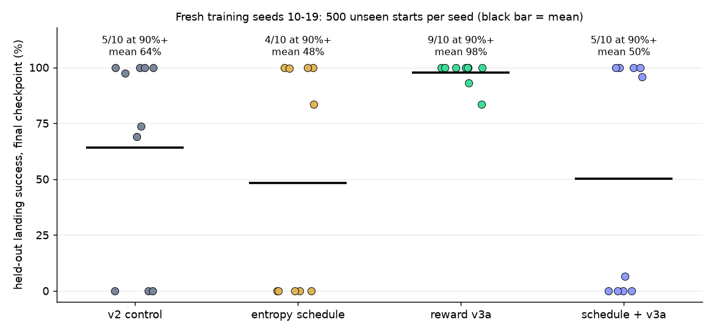

# Stabilising PPO training: making the final checkpoint reliable

Branch `stabilize` (from `headline`). Question: with reward v2 and fixed observation scales, 3 of 10 seeds
ended with a bad `final.pt` (hl_v2 seeds 4, 6, 8) and many more swung between 0% and 100% across the last
checkpoints (`docs/headline-results.md`). Can a training-side change make `final.pt` reliably good
(target: >= 9/10 seeds >= 90% held-out success, same seeds 0-9)?

## Result in one paragraph

With `experiments/configs/st_c_ed30lr.json` (entropy bonus held at 0.03 for the first 30% of training,
decayed linearly to 0 by 80%, LR floor at 10% of its peak instead of annealing to 0; everything else =
`ppo_final_v2`), **9 of 10 seeds reach >= 99.6% held-out success with `final.pt`** (500 episodes, seeds
50000-50499), mean 89.9% (hl_v2: 7/10 seeds >= 90%, mean 77.0%). The target (>= 9/10) is met, but
only just: one seed (9) still ends in a 0% hover-until-the-fuel-runs-out policy, the paired improvement
over hl_v2 is **not statistically significant** (paired sign-flip p = 0.50, n = 10), and most of the
gain on seeds 0-9 comes from the two seeds that were used to choose the config (see "What changed").
The late greedy collapses of learned seeds are clearly reduced in the training logs (below). A
second round on 10 fresh seeds (four arms) is in the section "Round 2": it did **not** replicate this gain, while
reward `v3a` did (table there).

## What was implemented (all backward compatible)

Defaults reproduce the previous behaviour exactly: a 40,960-step run with `ppo_final_v2.json` before and
after the change gave identical `metrics.jsonl` (except for the new `ent_coef` key), `eval.jsonl` and final
weights. New options (unit tests in `tests/test_schedules.py`, 139 tests pass):

| option | where | meaning | default |
|---|---|---|---|
| `ent_coef_final`, `ent_decay_start`, `ent_decay_end` | `ppo` | entropy coefficient is held at `ent_coef` until `ent_decay_start` (fraction of training), then linear to `ent_coef_final` at `ent_decay_end`, then constant | `null` (constant `ent_coef`) |
| `lr_final_frac`, `lr_schedule` | `ppo` | LR goes from `learning_rate` to `learning_rate * lr_final_frac` ("linear" or "cosine") when `anneal_lr` is true | 0.0, "linear" (the original schedule) |
| `eval_stochastic` | top level | every in-training eval also rolls out SAMPLED actions on the same seeds; adds `stoch_success_rate`, `stoch_crash_rate`, `stoch_out_of_bounds_rate`, `stoch_timeout_rate`, `stoch_mean_reward` to `eval.jsonl` (existing keys unchanged) | false |

`metrics.jsonl` now also logs the `ent_coef` used in each update. Checkpoints are still saved every 50
updates. `clip_vloss` already existed; return normalisation was NOT implemented because the diagnosis does
not point to value or advantage scale (see below). `scripts/run_queue.sh` runs a job list with bounded
parallelism and retries a dead job (no job died); `scripts/stabilisation_analysis.py` does the evaluation and
paired statistics.

## Diagnosis (from the DIAGNOSTICIAN agent; "confirmed" = checked on rollouts/logs by them, I have not
re-derived it)

- Late collapses are greedy-evaluation collapses of a policy that still lands when it samples: on hl_v2
  s8 the in-training sampled episodes keep ~100% success while greedy eval is 0% at updates 1140 and
  1160-1220. Entropy does not collapse (it stays ~1.0 nats of a maximum 1.386) and LR is ~1e-5 or less
  there, so annealing is not what flips the policy. (confirmed)
- Essentially every failure is the rocket running out of fuel before touchdown: 558 of 601 crash-dominated
  late greedy evals have mean fuel used >= 0.99. The collapsed greedy policy uses MAIN ~50% of steps at
  every altitude, descends at 3-6 m/s and takes ~700 steps (the whole tank); healthy seeds use altitude-
  dependent thrust, ~320 steps and ~35% of the fuel. (confirmed)
- The trained policy uses p(MAIN) as a soft throttle; argmax over-fires MAIN where MAIN is the plurality but
  < 50%, so greedy and sampled are different controllers and PPO only optimises the sampled one. On
  collapsed checkpoints sampling at temperature 1 lands 86-99% while greedy lands 0%. Top-1/top-2
  probability margin < 0.1 on 58-64% of greedy steps. Across 12 learned seeds, Spearman(collapse fraction,
  mean entropy) = +0.81 (small n, correlational). (confirmed for the rollouts, the entropy link is
  suggestive only)
- Nothing in the v2 objective pushes away from the fuel cliff once success is ~100%: a 234-step landing
  scores ~100.6 raw return vs ~96.6 for a 662-step one. The policy can drift into hover-until-empty and, once
  no landing occurs in a batch, there is no signal to climb back (v1 s5 log). (confirmed for the log, the
  generalisation is a hypothesis)
- Two failure classes: (1) late greedy collapse of a policy that learned (hl_v2 s4, s8, and the 0/100%
  alternation of s7, s9): addressable by what happens late in training; (2) never learns / hover until
  empty (hl_v2 s6: all 16 envs identical return from update ~200, value loss 0): a late-training change
  cannot rescue it. Value/advantage scale was ruled out (explained variance 0.97-0.999 in collapse windows).
- Reward-side levers (fuel/time-aware reward v3) are being tested separately by the REWARD-V3 agent; this
  document only uses reward v2.

These findings pointed at: sharpen the policy late (entropy decay to 0) and keep the LR from freezing the
policy while it does so (LR floor).

## Configs tried and how one was chosen

Three candidate configs, all reward v2, fixed obs scales, 5M steps, seeds 6, 7, 8 (the worst hl_v2 seeds:
6 and 8 at 0% final, 7 alternating 0/100% in its last checkpoints). Pilot runs are `stp_<cfg>_s{6,7,8}`.

| config | change vs `ppo_final_v2` |
|---|---|
| `st_a_ed50` | ent_coef 0.03 held until 50% of updates, linear to 0 at the end; LR unchanged (linear to 0) |
| `st_b_ed50lr` | as a, plus `lr_final_frac = 0.1` |
| `st_c_ed30lr` | ent_coef 0.03 held until 30%, linear to 0 at 80%, 0 for the last 20%; `lr_final_frac = 0.1` |

All three also set `eval_stochastic: true`. Rule (decided before any pilot run finished, but not committed
anywhere before this document): choose the config with the most pilot seeds whose `final.pt` has greedy
success >= 90%, ties broken by the mean over seeds of (final success + mean of the last 5 checkpoints)/2.
Pilot evaluation used its own held-out range, seeds 60000-60299 (300 episodes), so the confirmation range
50000-50499 stayed untouched (`experiments/stab_pilot.json`):

| config | s6 final (sampled) | s7 final (sampled) | s8 final (sampled) | seeds >= 90% | tie-break score |
|---|---|---|---|---|---|
| a_ed50 | 0.0% (0.0%) | 100.0% (99.3%) | 0.0% (0.0%) | 1/3 | 0.333 |
| b_ed50lr | 100.0% (100.0%) | 100.0% (97.3%) | 100.0% (100.0%) | 3/3 | 0.9975 |
| c_ed30lr | 100.0% (99.3%) | 99.7% (89.3%) | 100.0% (99.7%) | 3/3 | 0.9993 |

b and c tie on the main criterion and c wins the tie-break by 0.002, which is noise; the pilot cannot
distinguish them. **Number of configs tried: 3** (no configs were discarded unseen, no other lever was
run). a is a clean ablation of "entropy decay alone": its first 610 updates (the hold phase) are
bit-identical to hl_v2 on all three seeds (metrics compared update by update), so it diverges from the
hl_v2 run only at update 611. a's finals (s6 0%, s7 100%, s8 0%) are the same as hl_v2's (0%, 100%, 0%):
on these seeds the entropy decay alone changed nothing (on s8 the policy also collapses when sampled).
b and c change the LR from update 2 on, so their trajectories differ from hl_v2 from the start; they rescued
s6 and s8, but no LR-floor-only config was run, so the pilot cannot separate "a higher late LR lets the
sharpening policy repair itself" from "a different random trajectory".

The confirmation runs for seeds 6, 7, 8 are copies of the pilot runs `stp_c_ed30lr_s{6,7,8}` (same config,
deterministic training), not new trainings; seeds 0-5 and 9 were trained after the config was fixed.

## Confirmation: `st_c_ed30lr`, seeds 0-9, `final.pt` (update 1220)

Evaluation: `uv run python scripts/stabilisation_analysis.py eval --prefix st_c_ed30lr --episodes 500
--seed-start 50000 --out experiments/stab_eval.json`, greedy, 500 held-out episodes per seed (50000-50499,
disjoint from training and in-training eval seeds by `assert_heldout`); last-5 checkpoints (updates 1000-1200)
greedy on 200 episodes (50000-50199), exactly as for hl_v2 in `scripts/headline_analysis.py`. Heuristic
baseline on the same 500 seeds: 99.6%. hl_v2 columns are taken from `experiments/headline_eval.json`
(same seeds, same protocol). Wilson 95% CIs describe evaluation noise only.

| seed | st_c final (Wilson 95% CI) | crash/OOB/timeout | st_c last 5 ckpts % | hl_v2 final | hl_v2 last 5 % | st_c sampled-action final |
|---|---|---|---|---|---|---|
| 0 | 100.0% (500/500) 99.2-100.0% | 0/0/0 | 76 / 100 / 100 / 100 / 100 | 100.0% (500/500) | 100 / 70 / 100 / 100 / 100 | 98.0% |
| 1 | 100.0% (500/500) 99.2-100.0% | 0/0/0 | 100 / 100 / 97 / 100 / 100 | 99.8% (499/500) | 100 / 100 / 100 / 92 / 100 | 98.0% |
| 2 | 99.8% (499/500) 98.9-100.0% | 1/0/0 | 100 / 100 / 100 / 100 / 100 | 100.0% (500/500) | 100 / 100 / 100 / 100 / 100 | 99.0% |
| 3 | 100.0% (500/500) 99.2-100.0% | 0/0/0 | 100 / 100 / 100 / 92 / 100 | 100.0% (500/500) | 100 / 100 / 100 / 100 / 100 | 96.2% |
| 4 | 99.6% (498/500) 98.6-99.9% | 2/0/0 | 100 / 100 / 100 / 100 / 100 | 70.6% (353/500) | 100 / 100 / 100 / 0 / 50 | 99.0% |
| 5 | 100.0% (500/500) 99.2-100.0% | 0/0/0 | 100 / 100 / 100 / 91 / 68 | 99.8% (499/500) | 94 / 67 / 98 / 96 / 100 | 99.6% |
| 6 | 100.0% (500/500) 99.2-100.0% | 0/0/0 | 100 / 100 / 100 / 99 / 100 | 0.0% (0/500) | 0 / 0 / 0 / 0 / 0 | 99.4% |
| 7 | 100.0% (500/500) 99.2-100.0% | 0/0/0 | 100 / 100 / 100 / 100 / 100 | 100.0% (500/500) | 0 / 100 / 0 / 100 / 100 | 91.0% |
| 8 | 99.6% (498/500) 98.6-99.9% | 2/0/0 | 100 / 99 / 98 / 100 / 100 | 0.0% (0/500) | 100 / 100 / 100 / 100 / 0 | 99.8% |
| 9 | 0.0% (0/500) 0.0-0.8% | 493/7/0 | 0 / 0 / 0 / 0 / 0 | 100.0% (500/500) | 0 / 100 / 98 / 94 / 100 | 0.0% |

| | mean | median | min | seeds >= 90% | seeds > 50% | seeds at 0% |
|---|---|---|---|---|---|---|
| hl_v2 final | 77.0% | 99.9% | 0.0% | 7/10 | 8/10 | 2/10 |
| st_c_ed30lr final | 89.9% | 100.0% | 0.0% | **9/10** | 9/10 | 1/10 |

Exact binomial (Clopper-Pearson) 95% interval for "9 of 10 seeds >= 90%": 55%-99.7%. For hl_v2's 7 of 10:
35%-93%. Seeds with higher / lower / identical final success than hl_v2 (1-episode differences counted): 5 / 2 / 3.

Paired comparison with hl_v2 on the same training seeds (unit = seed, n = 10):

- Mean difference +12.9 points; paired bootstrap 95% CI -20.0 to +45.7; exact paired sign-flip permutation
  p = 0.50.
- Seeds >= 90%: 3 seeds only st_c (4, 6, 8), 1 seed only hl_v2 (9); exact McNemar p = 0.625.
- So with 10 seeds this experiment cannot show that st_c is better than hl_v2 on the final-checkpoint
  number; the observed difference is within seed-to-seed noise.

### Robustness of the final checkpoint (last 5 saved checkpoints, 200 episodes)

| | hl_v2 | st_c_ed30lr |
|---|---|---|
| seeds whose last-5 spread (max - min) > 20 points | 6/10 | 2/10 (s0: 76 -> 100, s5: 100 -> 68) |
| seeds with all 5 checkpoints >= 90% | 3/10 | 7/10 |
| mean of last-5 means | 77.1% | 88.3% |

`final.pt` lies inside the last-5 range for 9/10 st_c seeds. Not eliminated: st_c s5 still has checkpoints
at 91% and 68% (updates 1150 and 1200) although its final is 100%, and s0 had 76% at update 1000.

### Training-log diagnostics (9 seeds that learned in each arm: hl_v2 without s6, st_c without s9)

From `metrics.jsonl` / `eval.jsonl` of the runs (in-training greedy eval on 50 episodes, seeds
20000-20049; `experiments/stab_stats.json`, key `training_diag`):

| | hl_v2 (9 learned seeds) | st_c_ed30lr (9 learned seeds) |
|---|---|---|
| mean policy entropy, last 20 updates | 0.99 (0.88-1.05) | 0.70 (0.61-0.84) |
| greedy fuel used, mean of last 10 evals | 0.76 (0.46-1.00) | 0.53 (0.49-0.61) |
| greedy episode length, last 10 evals | 521 (317-700) | 354 (319-438) |
| greedy success, mean of last 10 evals | 79.3% | 98.6% |
| share of the last 25 evals with greedy success < 80% | 21.8% | 1.3% |
| greedy vs sampled eval success, last 10 evals | n/a (not logged) | 98.6% vs 97.1% |

So, among seeds that learn at all, the schedule does what the diagnosis asked: the policy is sharper, uses
~30% less fuel, stays away from the fuel cliff and greedy tracks sampled. The 9 st_c learned seeds meet the
diagnostician's proposed safe targets (greedy fuel <= 0.6 and steps <= 450) on every seed.

## What changed, honestly

1. **Late greedy collapses of learned seeds were reduced** (table above; hl_v2 s4 and s8 collapsed, st_c s4
   and s8 do not; last-5 spread > 20 points on 2 seeds vs 6). This is the part with real mechanism-level
   evidence, though it rests on 9 vs 9 learned seeds and on logs that were not designed as a controlled ablation.
2. **The never-learned/hover failure was not fixed.** 1 seed in 10 still ends in a hover-until-empty policy
   (st_c s9; hl_v2 s6). Which seed fails changed. The pilot runs of s6 under b and c learned, but the LR
   floor changes the trajectory from update 2 on, so "s6 recovered" and "s9 broke" may be luck of the
   trajectory rather than an effect of the config; the experiment cannot tell. A late-training change cannot
   in principle rescue a policy that already settled into the no-signal hover state by update ~200-600.
3. **Selection effect.** Seeds 6, 7, 8 were chosen for the pilot because they were the worst hl_v2 seeds.
   Re-running them with any config that changes the trajectory is expected to look better (regression to the
   mean), and those 3 seeds are also part of the confirmation. On the other 7 seeds (0-5, 9), where the config
   was not tuned, st_c has 6/7 seeds >= 90% and mean 85.6%, hl_v2 has 6/7 and mean 95.7% (paired mean
   difference -10.1 points, bootstrap CI -42.8 to +12.4, because s9 is 0% under st_c but 100% under
   hl_v2, while s4 goes 70.6% -> 99.6%). On the 3 pilot seeds: 99.9% vs 33.3%. So the seeds-0-9 headline
   "9/10 vs 7/10" is not an unbiased estimate of the improvement; the fresh-seed replication below is.
4. The target ">= 9/10 seeds >= 90% with `final.pt`" is met on seeds 0-9 with 9/10 (exactly at the
   threshold; seed-level 95% interval 55%-99.7%).

## Round 2: fresh seeds 10-19, four arms (analysis plan written before any held-out result)

Seeds 0-9 above were the first round (and seeds 6-8 doubled as pilot seeds). Round 2 is the clean
out-of-sample test: training seeds 10-19, never used for any choice, and every arm uses the SAME 10 training
seeds, so comparisons are paired by seed. Plan fixed here, before evaluating any of these runs on the
held-out range (I had looked at the in-training logs of some of the `st_c_ed30lr` seeds 10-13 while they
were running, nothing else):

| arm | run names | config |
|---|---|---|
| control (hl_v2 recipe) | `hlc_v2_s{10..19}` | `ppo_final_v2.json` (reward v2, constant entropy, LR to 0) |
| stabilised schedule | `st_c_ed30lr_s{10..19}` | `st_c_ed30lr.json` (reward v2 + entropy decay + LR floor) |
| reward v3a alone | `hlc_v3a_s{10..19}` | `ppo_final_v3a.json` (from the reward-v3 branch: v2 + time penalty 0.03 + landing fuel bonus) |
| combination | `stv3a_s{10..19}` | `st_c_v3a.json` = `st_c_ed30lr` schedule + reward v3a |

All arms are reported, whichever is best. Evaluation: `final.pt`, greedy and sampled actions, 500 held-out
episodes (seeds 50000-50499), mean fuel used and steps, last-5 checkpoints (200 episodes), per-seed Wilson
CIs. Primary outcome: number of seeds with held-out final success >= 90%. Secondary: mean success across
seeds, seeds > 50%, last-5 robustness, fuel, steps. Paired comparisons (per-seed success differences:
bootstrap 95% CI of the mean difference and exact sign-flip test; McNemar exact test on the >= 90%
indicator) of each of the three non-control arms against the control = 3 primary comparisons, plus 2
exploratory ones (combination vs st_c, combination vs v3a alone). All p-values are uncorrected for these 5
comparisons (x 2 tests) and n = 10 seeds per arm means only large differences (several seeds or tens of
points) can be detected; a difference that is not larger than that is reported as within noise.

### Round 2 results (final checkpoint, greedy, 500 held-out episodes per seed, seeds 50000-50499)



| arm | seeds at 90%+ | seeds above 50% | seeds at 0% | mean | median | min |
|---|---|---|---|---|---|---|
| v2 control (`hlc_v2`) | 5 of 10 | 7 | 3 | 64.0% | 85.5% | 0.0% |
| entropy schedule (`st_c_ed30lr`) | 4 of 10 | 5 | 5 | 48.3% | 41.7% | 0.0% |
| **reward v3a (`hlc_v3a`)** | **9 of 10** | **10** | **0** | **97.7%** | **100%** | **83.6%** |
| schedule + v3a (`stv3a`) | 5 of 10 | 5 | 4 | 50.2% | 51.2% | 0.0% |

Per-seed tables with Wilson intervals, sampled-action success, fuel, steps and the last five checkpoints are in
`experiments/r2_stats.json` (produced by `scripts/stabilisation_analysis.py arms`) and the four
`experiments/r2_*.json` evaluation files; `scripts/round2_summary.py` produced the figure and the two post hoc
analyses below. The training runs themselves are in `experiments/results/` (not committed).

**Pre-registered paired comparisons against the control** (per-seed differences, n = 10; p-values are exact
sign-flip tests, uncorrected for the three primary comparisons, so the Bonferroni threshold would be 0.017):

| comparison | mean difference | bootstrap 95% interval | sign-flip p | seeds better / worse / tied | seeds at 90%+ (arm vs control), McNemar p |
|---|---|---|---|---|---|
| entropy schedule vs control | -15.7 points | -60.6 to +30.9 | 0.59 | 3 / 5 / 2 | 4 vs 5, p = 1.0 |
| **v3a vs control** | **+33.7 points** | **+7.7 to +62.7** | **0.047** | **6 / 1 / 3** | **9 vs 5, p = 0.22** |
| schedule + v3a vs control | -13.8 points | -58.1 to +33.1 | 0.65 | 5 / 4 / 1 | 5 vs 5, p = 1.0 |
| exploratory: schedule + v3a vs v3a | -47.5 points | -78.7 to -15.9 | 0.051 | 2 / 7 / 1 | 5 vs 9, p = 0.22 |

v3a also uses less fuel (greedy, mean fraction of the tank 0.57 against 0.74, p = 0.07) and fewer steps (396
against 542), and its last five checkpoints are healthier (mean 90.2% against 59.7%; all five at 90%+ on 6 seeds
against 2). Sampled-action success is 95.5% for v3a against 68.5% for the control.

**What this means**

1. **The round-1 gain from the entropy schedule did not replicate.** On seeds it was never tuned on, it is
   below the control (48.3% against 64.0%), within noise either way. Round 1 had already warned that its gain
   came from the two seeds used to choose the config; this confirms it. Its failures are the same
   hover-until-the-fuel-runs-out mode as before (five seeds at 0%, all using the whole tank or crashing out of bounds).
2. **Reward v3a replicated.** It landed 500 of 500 on every seed 0-9 in the earlier round and reaches 97.7% mean
   on 10 new seeds with no seed at 0%. The new-seed comparison against the control is borderline on its own
   (p = 0.047, not significant after correcting for three comparisons), but the effect has the same direction
   and size as the first round.
3. **Combining the two was worse than v3a alone** (50.2% against 97.7%, p = 0.051, exploratory). I did not
   investigate why; a hypothesis (entropy going to zero leaves the policy with too little exploration to recover
   from a fuel-hungry mode) is untested and should not be quoted as a finding.

**Two analyses that were not pre-registered** (post hoc, labelled as such):

- *Seeds not used to choose between reward variants.* The v3a-versus-v3b pilot used training seeds 10-12, which
  are inside this round, so seeds 13-19 are the cleanest. There: control 52.7% (3 of 7 at 90%+), schedule
  54.7% (3 of 7), v3a 96.7% (6 of 7), combination 57.4% (4 of 7). v3a against the control is +43.9 points
  (bootstrap interval +9.6 to +83.4), but with only seven seeds the sign-flip test gives p = 0.125.
- *Pooled over all 20 seeds* (seeds 0-9 compared with the earlier `hl_v2` runs, which used the same recipe, and
  seeds 10-19 with the new control): v3a 98.8% mean against 70.5%, a difference of +28.3 points (bootstrap
  interval +10.9 to +47.8, sign-flip p = 0.004, 11 seeds better, 1 worse); 19 of 20 seeds at 90%+ against 12 of
  20 (McNemar p = 0.039).

**Remaining weaknesses of v3a.** Seeds 17 (83.6%) and 18 (93.0%) still crash on some starts (seed 18 uses 0.91
of the tank, close to the fuel cliff). Several seeds have a weak checkpoint among their last five (seeds 11, 13,
17 and 18), so the final checkpoint is still partly a draw. Greedy v3a is slower and burns more fuel than the
hand-written controller (0.57 of the tank and 396 steps, against 0.37 and 270), and its sampled-action version
crashes about 4.5% of the time, the reverse of the earlier greedy-only failure.

## Limitations

- n = 10 seeds per arm; one run per seed. Seed-level uncertainty dominates; per-seed Wilson intervals
  cover evaluation noise only.
- The pilot used 3 seeds and 3 configs; the config choice among b and c is a coin flip and no ablation
  separates the entropy decay from the LR floor (a, without the floor, failed on 2 of 3 pilot seeds).
- Seeds 6-8 are both pilot and confirmation seeds (see "What changed").
- Held-out episodes come from the same initial-state distribution as training; greedy policy is the
  deliverable; sampled-action numbers are secondary.
- Diagnosis statements marked "confirmed" come from the DIAGNOSTICIAN agent's rollouts; I verified only
  the training-log diagnostics reported in the table above.
- Reward v3 and checkpoint selection are separate experiments (other branches) and are not part of
  these numbers.

## Reproduction

```
uv sync --extra torch --extra plots
# pilot (3 configs x seeds 6,7,8) and confirmation (seeds 0-9) used scripts/run_queue.sh, e.g.
#   echo "experiments/configs/st_c_ed30lr.json 0 st_c_ed30lr_s0" > jobs.txt; scripts/run_queue.sh jobs.txt 4
uv run python -m rocket_landing.train --config experiments/configs/st_c_ed30lr.json --seed N --run-name st_c_ed30lr_sN
uv run python scripts/stabilisation_analysis.py eval --prefix st_c_ed30lr --seeds 0 1 2 3 4 5 6 7 8 9 \
    --episodes 500 --seed-start 50000 --out experiments/stab_eval.json
uv run python scripts/stabilisation_analysis.py stats --eval experiments/stab_eval.json \
    --baseline experiments/headline_eval.json --out experiments/stab_stats.json \
    --base-results <dir with hl_v2_s* runs> --subset pilot_seeds=6,7,8 --subset other_seeds=0,1,2,3,4,5,9
uv run python scripts/stabilisation_analysis.py plots --eval experiments/stab_eval.json
```

Checkpoints are not committed except `experiments/results/st_c_ed30lr_s2/final.pt` (99.8% final, every
one of its last 5 checkpoints >= 99.5%; a typical, not a cherry-picked-best, run of the arm). Figure:
`docs/figures/stabilisation_final_strip.png`.
